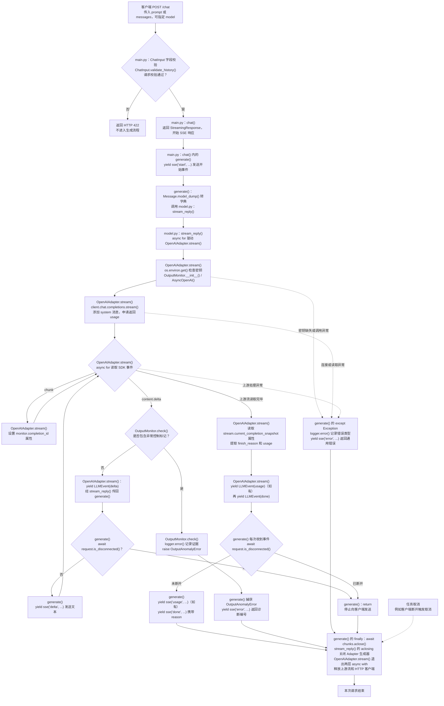

# 07：请求进入后的流程

根据当前代码绘制，入口为 `POST /chat`。

## 函数与职责对照

| 文件 | 函数 / 方法 | 职责 |
| --- | --- | --- |
| `main.py` | `ChatInput.validate_history()` | 校验消息历史，或把 prompt 转为单条 user 消息；字段约束由 Pydantic 校验 |
| `main.py` | `chat()` | `/chat` 路由入口，返回 StreamingResponse |
| `main.py` | `chat()` 内的 `generate()` | 驱动模型流、判断断开、分发事件、捕获异常并清理 |
| `main.py` | `sse(event, data)` | 把事件名和字典编码为 SSE 字符串 |
| `model.py` | `stream_reply()` | 委托 Adapter，转发内部事件并传播关闭 |
| `adapters/openai_adapter.py` | `OpenAIAdapter.stream()` | 调用上游、转换 SDK 事件、提取用量与结束原因 |
| OpenAI SDK | `client.chat.completions.stream()` | 创建上游流上下文 |
| `output_monitor.py` | `OutputMonitor.__init__()` / `check()` | 初始化诊断状态；检查分片、记录异常并抛错 |
| `schemas.py` | `LLMEvent.validate_payload()` | 构造内部事件时校验 type 与载荷是否匹配 |
| Starlette Request | `request.is_disconnected()` | 检查客户端是否断开 |

`stream.current_completion_snapshot` 是属性；`async for`、`yield`、`async with` 是语法，不是额外的业务函数。

## 阅读要点

- **请求校验**：`prompt` 与 `messages` 不能同时传入；消息从 user 开始，user / assistant 交替，最后一条必须为 user，并受字符数和条数限制。当前只接受 `deepseek-flash`。
- **按需执行**：调用 `stream_reply()` 只是创建异步生成器；开始遍历时才执行 Adapter。因此 SSE `start` 在实际模型调用之前发出，缺少密钥时也可能先收到 `start`，随后收到 `error`。
- **职责分层**：Adapter 把 SDK 事件转换为统一的 `LLMEvent`；`model.py` 负责委托与关闭传播；`main.py` 把内部事件编码为 SSE。`BaseLLMAdapter` 定义接口约束，不是额外执行步骤。
- **输出监测**：每个文本分片发出前都会检查，能够识别跨分片的 `<|im_end|>`；命中时拦截当前分片，但之前已经发送的文本不会撤回。
- **成功顺序**：`start → delta × N → usage（可选）→ done`。`done` 表示上游结束，具体原因以 `reason` 为准。
- **断开与清理**：代码在取得每个内部事件后检查连接；框架也可能通过取消任务停止生成。取消不由普通 `Exception` 分支处理，但仍会执行清理。清理操作是幂等关闭，上游资源可能已在退出 `async with` 时释放。

对应源码：[`main.py`](main.py)、[`model.py`](model.py)、[`adapters/openai_adapter.py`](adapters/openai_adapter.py)、[`output_monitor.py`](output_monitor.py)、[`schemas.py`](schemas.py)。
