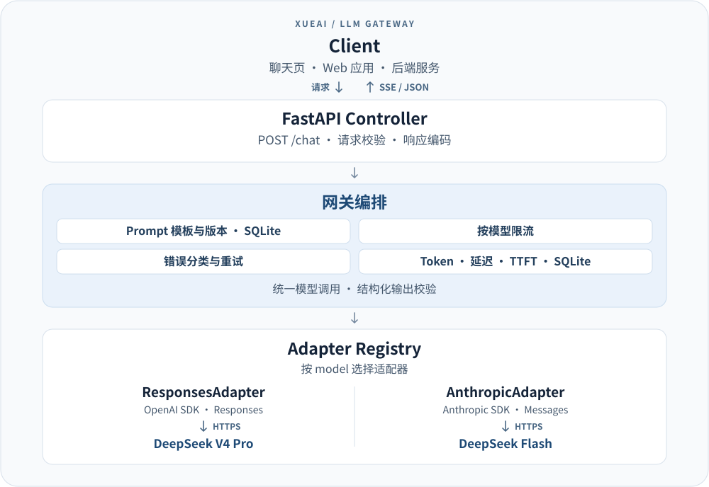

# xueAI · 从 SSE 到 LLM Gateway

这是一个分 21 关推进的 Python 学习项目：从 FastAPI SSE 推送开始，逐步构建支持双模型、结构化输出、模板管理、可观测性、重试和限流的 LLM Gateway。

**使用完整项目，请从 [第 21 关最终版](21_LLM_Gateway_Final/README.md) 开始。** 第 01–20 关保留各阶段的实现，方便学习、独立运行和对比。

## 系统架构



应用通过同一个 `/chat` 接口选择模型和响应方式，DeepSeek API Key 由网关服务端持有。调用记录可在 `/observability` 查看，包含 Token、总延迟和首个非空文本增量的时间（TTFT）。

## 推荐入口

| 目标 | 入口 |
| --- | --- |
| 启动完整网关、了解接口和 curl 用法 | [最终版 README](21_LLM_Gateway_Final/README.md) |
| 查看测试结果、真实模型调用与已知限制 | [最终验收记录](21_LLM_Gateway_Final/ACCEPTANCE.md) |
| 执行默认不消耗 API Token 的验收 | [一键验收脚本](21_LLM_Gateway_Final/scripts/verify.py) |
| 从零学习 SSE 与异步流式调用 | [第 01 关](01_Intro/README.md)，随后按编号推进 |
| 阅读完整实现的调用链 | [HTTP 入口](21_LLM_Gateway_Final/main.py) → [模型入口](21_LLM_Gateway_Final/model.py) → [适配器注册表](21_LLM_Gateway_Final/adapters/registry.py) |

## 关卡导航

每个链接指向该关自己的说明。历史关卡的能力、依赖和端口可能不同，以对应 README 为准。

| 关卡 | 目录与说明 | 本关学习目标 |
| --- | --- | --- |
| 01 | [SSE Intro](01_Intro/README.md) | 用 FastAPI 建立 SSE 推送，理解事件格式与客户端接收 |
| 02 | [Fake AI](02_FakeAI/README.md) | 模拟逐段生成，处理停止请求和错误，无需 API Key |
| 03 | [DeepSeek](03_DeepSeek/README.md) | 接入真实 DeepSeek Flash，转换上游流式响应 |
| 04 | [Multi-turn](04_MultiTurn/README.md) | 传递多轮消息历史，管理聊天上下文 |
| 05 | [Model Selection](05_Model/README.md) | 在请求中指定模型，传递并校验模型参数 |
| 06 | [Typed Events](06_Events/README.md) | 定义内部类型化事件，将模型层与 SSE 编码分离 |
| 07 | [Adapter](07_Adapter/README.md) | 抽象模型适配器接口，封装具体 SDK 调用 |
| 08 | [Registry](08_Registry/README.md) | 通过注册表按模型名选择适配器 |
| 09 | [Anthropic Messages](09_Anthropic/README.md) | 让 Flash 使用 Anthropic Messages 协议 |
| 10 | [OpenAI Responses](10_Responses/README.md) | 接入 Pro 的 Responses 协议，形成双协议路由 |
| 11 | [Non-streaming](11_NonStreaming/README.md) | 在同一聊天接口支持非流式与 SSE 输出 |
| 12 | [JSON Object](12_JSONObject/README.md) | 请求并验证非流式 JSON 对象输出 |
| 13 | [JSON Schema](13_JSONSchema/README.md) | 用 Schema 约束并校验非流式结构化输出 |
| 14 | [Streaming JSON](14_StreamingJSON/README.md) | 支持流式结构化输出与最终完整性校验 |
| 15 | [Prompt Template](15_PromptTemplate/README.md) | 引入 Prompt 模板和变量替换 |
| 16 | [Prompt Version](16_PromptVersion/README.md) | 使用 SQLite 保存模板与历史版本 |
| 17 | [Observability](17_Observability/README.md) | 记录 Token、延迟、TTFT 和逐次调用指标 |
| 18 | [Error Handling](18_ErrorHandling/README.md) | 统一错误码、异常分类与对外错误契约 |
| 19 | [Retry](19_Retry/README.md) | 实现可取消的指数退避，限制流式重试时机 |
| 20 | [Rate Limit](20_RateLimit/README.md) | 实现按模型独立、并发安全的滑动窗口限流 |
| 21 | [LLM Gateway Final](21_LLM_Gateway_Final/README.md) | 修正缓存 Token 统计，完成回归、文档和交付验收 |

推荐按三个阶段学习：**01–06** 掌握流式聊天与事件边界；**07–14** 理解适配器、双协议和结构化输出；**15–21** 完善模板、观测、可靠性与交付。已有相关基础时，可以直接阅读最终版，再回看感兴趣的关卡。

## 快速验证最终版

以下命令从仓库根目录开始，适用于 macOS / Linux。需要 Python 3.11+，最终验收使用 Python 3.13.3。

```bash
cd 21_LLM_Gateway_Final
python3 -m venv .venv
source .venv/bin/activate
python -m pip install -r requirements.lock.txt
python scripts/verify.py
```

默认使用模拟 Provider，不需要 API Key，也不消耗真实 Token。脚本会汇总验收分组，失败时返回非零退出码。2026-11-08 的验收记录为 **133 项测试通过**；详细范围与真实调用证据见[验收记录](21_LLM_Gateway_Final/ACCEPTANCE.md)。

需要运行真实聊天时，在上面的最终版目录和虚拟环境中继续：

```bash
cp .env.example .env
# 在本地编辑 .env，填写 DEEPSEEK_API_KEY
python -m uvicorn main:app --env-file .env --host 127.0.0.1 --port 8013 --workers 1
```

打开 [聊天页](http://127.0.0.1:8013/)、[观测页](http://127.0.0.1:8013/observability) 或 [API 文档](http://127.0.0.1:8013/docs)。真实请求需要有效 Key 和账户额度。Windows PowerShell 命令、请求示例及可选 `--live` 验收方式见[最终版运行说明](21_LLM_Gateway_Final/README.md)。

## 目录与维护约定

- 各关目录是独立的学习阶段快照，重复代码用于展示演进过程；不要把它们当作需要同时运行的多个服务。
- 后续功能开发和修复建议集中在 `21_LLM_Gateway_Final/`；第 01–20 关作为历史参考，不自动同步最终版改动。
- 运行某一关前，进入该关目录并按其 README 安装依赖。部分历史关卡使用相同端口，同时运行时需自行区分端口。
- 最终版的 `tests/` 保存回归测试，`scripts/` 保存验收入口，`evidence/` 保存合成请求的验收结果。根目录负责导航，完整 API 与实现边界集中在最终版 README。
- API Key、`.env`、虚拟环境、SQLite 运行数据库和日志不纳入版本控制。新环境按说明自行创建，不依赖开发者机器上的已有环境。

最终版仍采用**单进程内存限流**；最多重试 3 次，即最多 4 次上游尝试；流式结构化输出可能在最终校验前发出部分增量。部署和客户端处理前请阅读[已知限制](21_LLM_Gateway_Final/README.md#10-已知限制)。
